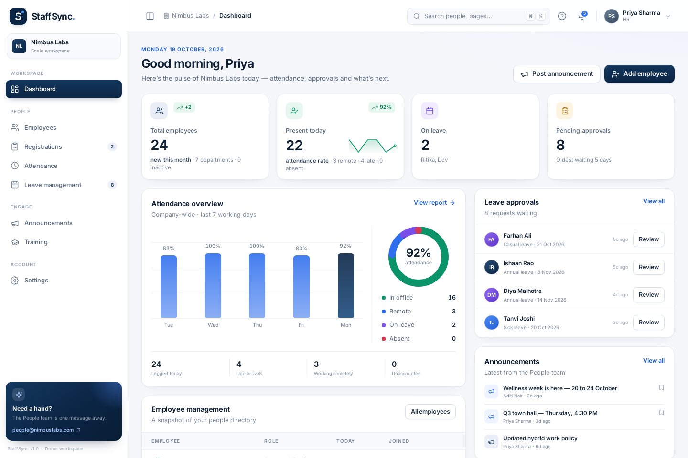
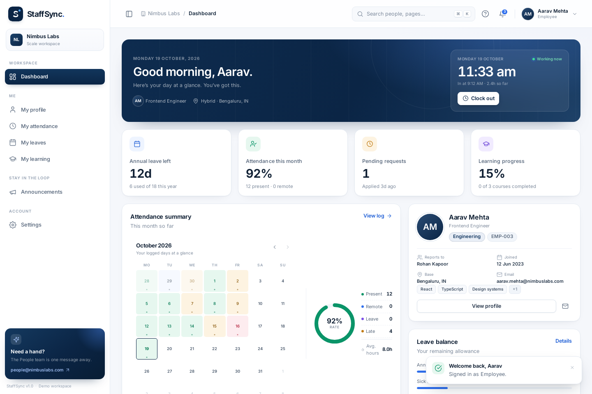
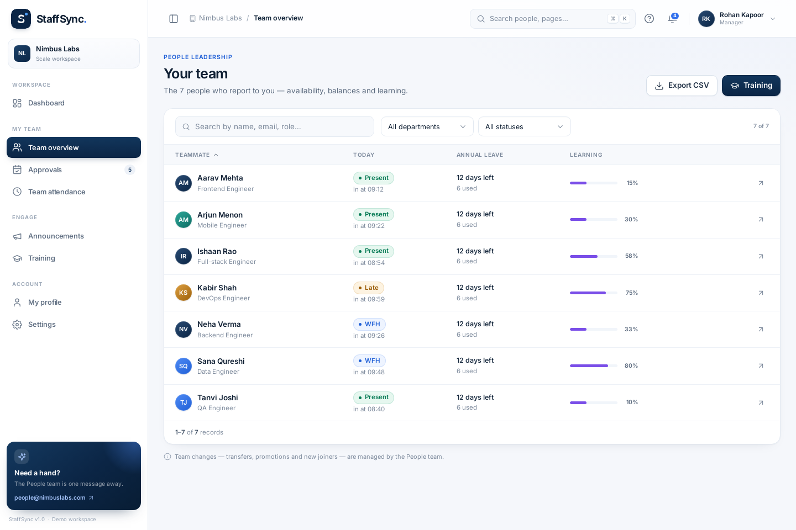
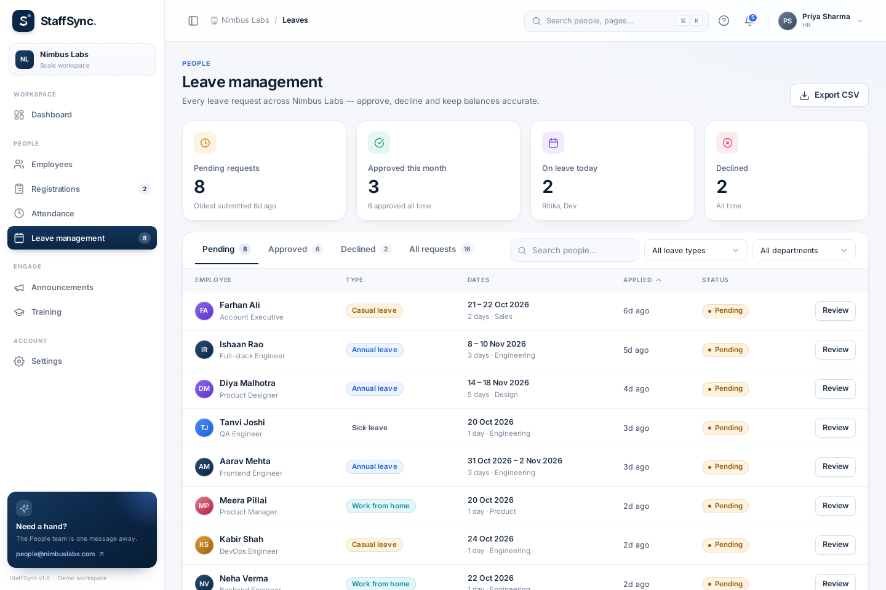
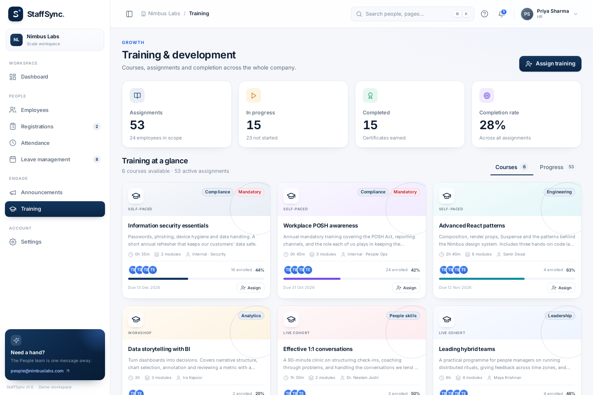

# StaffSync — HR Management System

StaffSync is a full-stack Human Resource Management System (HRMS) designed to manage employees, attendance, leave requests, payroll-related information, and other HR operations through a centralized dashboard.



## Table of Contents

1. [Screenshots](#screenshots)
2. [First Run in Six Commands](#first-run-in-six-commands)
3. [What You Get](#1-what-you-get)
4. [Requirements](#2-requirements)
5. [Create the Database (MongoDB Atlas)](#3-create-the-database-mongodb-atlas)
6. [Run the Backend](#4-run-the-backend)
7. [Run the Frontend](#5-run-the-frontend)
8. [Sign In and Demo Accounts](#6-sign-in--demo-accounts)
9. [Environment Variables](#7-environment-variables)
10. [Everyday Commands](#8-everyday-commands)
11. [API Reference and Required Roles](#9-api-reference--required-roles)
12. [Business Rules Enforced by the Server](#10-business-rules-enforced-by-the-server)
13. [Security Notes](#11-security-notes)
14. [Automated Tests and Acceptance Results](#12-automated-tests--acceptance-results)
15. [Troubleshooting](#13-troubleshooting)
16. [Project Structure](#14-project-structure)
17. [Manual QA Checklist](#15-manual-qa-checklist)
18. [Known Limitations](#16-known-limitations)
19. [License](#license)
20. [Contributing](#contributing)

## Screenshots

Explore the main StaffSync interfaces below. These images are stored in the repository under `docs/screenshots/`.

### Employee Dashboard and Manager Team View

| Employee Dashboard | Manager Team View |
|:---:|:---:|
|  |  |

### Leave Management and Training

| HR Leave Management | HR Training |
|:---:|:---:|
|  |  |

### More Screenshots

Additional screenshots cover login, registration, employee management, attendance, announcements, settings, employee leave requests, training, profiles, notifications, and manager workflows.

Browse all available images in [`docs/screenshots/`](docs/screenshots/).

## First Run in Six Commands

Open two terminals from the project root.

**Terminal 1 — Backend**

```bash
cd Server
npm install
npm run seed
npm run dev
```

**Terminal 2 — Frontend**

```bash
cd Client
npm install
npm run dev
```

Before running the seed command, configure MongoDB and the required environment variables as described below.

Open the frontend URL printed by Vite, normally [http://localhost:5173](http://localhost:5173).

## 1. What You Get

StaffSync provides a centralized interface for HR-related workflows.

### Frontend

- React 18
- Vite development server
- Plain CSS styling
- Dashboard-based interface
- Role-aware navigation and screens

### Backend

- Node.js
- Express.js
- MongoDB
- Mongoose
- JWT-based authentication
- REST API endpoints

### Main Capabilities

Depending on the configured modules, the application supports:

- Employee information management
- Attendance management
- Leave requests and approvals
- HR dashboards
- Payroll-related information
- Role-based access to protected operations

The backend is responsible for enforcing authentication, authorization, and applicable business rules.

## 2. Requirements

Install the following before starting:

- Node.js and npm
- MongoDB Atlas account or a compatible MongoDB deployment
- Git
- A modern web browser

Check your installed versions:

```bash
node --version
npm --version
git --version
```

Use a Node.js version compatible with the project's dependencies.

## 3. Create the Database (MongoDB Atlas)

1. Open [MongoDB Atlas](https://www.mongodb.com/atlas).
2. Create a project and a database deployment.
3. Create a database user with a strong password.
4. Configure network access to permit your development machine.
5. Copy your MongoDB connection string.
6. Replace the username, password, and database name placeholders with your actual values.
7. Add the connection string to the backend environment configuration.

Example connection string:

```env
MONGODB_URI=mongodb+srv://<username>:<password>@<cluster-host>/<database-name>?retryWrites=true&w=majority
```

Replace all placeholders before running the application.

**Important:** Never commit a real database URI, password, or other secret to GitHub.

## 4. Run the Backend

Open a terminal in the project root:

```bash
cd Server
npm install
```

Configure the backend environment variables in `Server/.env`.

Example:

```env
PORT=5000
MONGODB_URI=<your-mongodb-connection-string>
JWT_SECRET=<your-long-random-secret>
```

Use the actual variable names expected by the backend code. If the project uses additional environment variables, configure those too.

### Seed the Database

After configuring the database connection and environment variables, run:

```bash
npm run seed
```

This initializes the demo data supported by the project's seed script.

### Start the Backend

```bash
npm run dev
```

The backend normally runs at:

[http://localhost:5000](http://localhost:5000)

Keep this terminal open while using the application.

## 5. Run the Frontend

Open a second terminal in the project root:

```bash
cd Client
npm install
npm run dev
```

Vite normally serves the frontend at:

[http://localhost:5173](http://localhost:5173)

Open the URL displayed in the terminal.

If the frontend cannot communicate with the backend, verify the backend URL, API configuration, server status, and any required CORS settings.

## 6. Sign In and Demo Accounts

The following demo accounts are documented for local development, provided they are created by the project's seed script.

| Role | Email | Password |
|---|---|---|
| Admin / HR | `priya.sharma@nimbuslabs.com` | `StaffSync@123` |
| Manager | `rohan.kapoor@nimbuslabs.com` | `StaffSync@123` |
| Employee | `aarav.mehta@nimbuslabs.com` | `StaffSync@123` |

The exact permissions depend on the roles and authorization rules implemented in the backend.

If an account does not work, confirm that:

- The database is connected.
- The seed command completed successfully.
- The email and password match the seeded records.
- The backend is running.
- The frontend is sending requests to the correct API.

**Security warning:** These are demo credentials, not production credentials. Never deploy publicly with shared demo passwords or use them to protect real employee data.

## 7. Environment Variables

Environment variables hold configuration that should not be hard-coded into the source.

### Backend

Typical settings include:

| Variable | Purpose |
|---|---|
| `PORT` | Backend server port |
| `MONGODB_URI` | MongoDB connection string |
| `JWT_SECRET` | Secret used for signing or verifying authentication tokens |

Your implementation may require additional variables. Check the backend configuration and environment-variable references before starting the application.

### Frontend

If the frontend uses a Vite environment variable for the backend URL, configure it using the variable name expected by the code. Vite variables exposed to the browser generally use the `VITE_` prefix.

For example, only if supported by the implementation:

```env
VITE_API_URL=http://localhost:5000
```

Do not place database credentials, JWT signing secrets, or other private backend secrets in frontend environment variables.

### Environment File Safety

Keep local environment files out of version control:

```gitignore
.env
.env.*
!.env.example
!.env.*.example
```

You may commit example files containing placeholder values, but never commit real secrets.

## 8. Everyday Commands

Run commands from the appropriate directory.

### Backend

```bash
cd Server
npm install
npm run dev
npm run seed
```

### Frontend

```bash
cd Client
npm install
npm run dev
```

### Testing

Run the test commands defined in each package's `package.json`.

For example, if the relevant scripts are configured:

```bash
cd Server
npm test
```

```bash
cd Client
npm test
```

To inspect available scripts:

```bash
npm run
```

Run the tests against the current code before publishing updated test results in this README.

## 9. API Reference and Required Roles

StaffSync uses a REST API for communication between the frontend and backend.

The API routes, HTTP methods, request bodies, response formats, and role requirements are defined by the backend implementation.

Typical API categories include:

| Category | Purpose |
|---|---|
| Authentication | Sign in and authenticate users |
| Employees | Retrieve and manage employee records |
| Attendance | Manage attendance information |
| Leave | Submit, retrieve, and process leave requests |
| Dashboard | Retrieve summary information |
| Payroll | Access supported payroll-related functionality |

This table describes functional categories, not a guaranteed list of route paths.

Before documenting individual endpoints, verify the actual Express route definitions and middleware in the `Server` directory.

Protected endpoints should validate the authentication token and enforce the required role or permissions on the server. Hiding a button in the frontend is not sufficient authorization.

## 10. Business Rules Enforced by the Server

Business rules should be enforced by the backend rather than relying only on frontend validation.

Depending on the implemented modules, these rules may include:

- Authentication before accessing protected resources.
- Role-based authorization for restricted actions.
- Validation of required fields and supported input values.
- Validation of employee, attendance, and leave records.
- Prevention of unauthorized modifications.
- Consistent handling of invalid requests and database errors.

Refer to the backend implementation and tests for the exact rules currently enforced. Do not assume a rule is implemented unless it is supported by code or verified tests.

## 11. Security Notes

Follow these practices when developing, testing, or deploying StaffSync.

- Keep `.env` files and private credentials out of Git.
- Use a strong, randomly generated JWT secret.
- Do not use demo passwords in production.
- Restrict database network access and database-user permissions.
- Validate and sanitize incoming request data.
- Enforce permissions on the backend.
- Avoid exposing sensitive employee information in API responses or logs.
- Use HTTPS when deploying publicly.
- Keep dependencies updated and review security advisories.
- Configure production CORS settings for trusted origins.
- Use appropriate password hashing for stored passwords.
- Do not expose backend secrets through frontend configuration.

Before using StaffSync with real employee data, perform a security review and verify the authentication, authorization, data-protection, and deployment configurations.

## 12. Automated Tests and Acceptance Results

StaffSync includes automated tests and acceptance checks for supported functionality.

Test results should reflect the latest successful test run on the current version of the project.

Record the following when validating a release:

- Backend test count and pass/fail results
- Frontend test count and pass/fail results
- Acceptance-check results
- Any known failing or skipped tests
- The environment in which tests were executed

Do not treat a previously recorded test count as proof that the current code passes. Re-run the relevant test commands after making changes.

For reproducible results, document the command used and the test output.

## 13. Troubleshooting

### Backend Does Not Start

- Confirm that Node.js and npm are installed.
- Run `npm install` inside `Server`.
- Check that required environment variables exist.
- Confirm that the configured port is available.
- Review the terminal output for the actual error.

### MongoDB Connection Fails

- Verify the connection string.
- Confirm the database username and password.
- Check MongoDB Atlas network access.
- Confirm that the database deployment is available.
- Check whether special characters in the password need URL encoding.

Do not share a real database connection string when asking for help.

### Frontend Does Not Start

- Run `npm install` inside `Client`.
- Check for dependency or syntax errors.
- Confirm the port selected by Vite.
- Open the browser console and inspect any errors.

### Sign-In Fails

- Confirm that the backend is running.
- Verify that the frontend is calling the correct API.
- Check whether the demo accounts were successfully seeded.
- Inspect the backend logs for authentication or database errors.
- Confirm that the login request matches the API's expected payload.

### API Requests Fail

- Check the backend URL and port.
- Verify the route path and HTTP method.
- Inspect the browser's Network panel.
- Confirm that the request includes the required authentication token.
- Check CORS configuration and server logs.

### DNS or Network Connection Problems

If the project provides dedicated DNS troubleshooting scripts, inspect the available scripts before using them:

```bash
npm run
```

Use a DNS-specific workaround only when the error indicates a DNS-resolution problem. It should not replace fixing an incorrect connection string, unavailable server, or invalid credentials.

## 14. Project Structure

The repository is organized into separate frontend and backend applications.

```text
StaffSync/
├── Client/
│   ├── public/
│   ├── src/
│   ├── package.json
│   └── ...
├── Server/
│   ├── package.json
│   ├── ...
│   └── .env
├── .gitignore
└── README.md
```

This is a simplified overview. Refer to the repository for the complete directory structure.

The `Client` directory contains the frontend application, while `Server` contains the backend and its supporting modules.

The local `Server/.env` file should remain untracked and should not be included in public repository contents.

## 15. Manual QA Checklist

Use this checklist when verifying the application.

- [ ] Backend starts without errors.
- [ ] Frontend starts without errors.
- [ ] MongoDB connects successfully.
- [ ] Demo data can be seeded.
- [ ] A valid user can sign in.
- [ ] Invalid login credentials are rejected.
- [ ] Protected pages require authentication.
- [ ] Role-restricted operations are denied to unauthorized users.
- [ ] Employee records load correctly.
- [ ] Attendance functionality works as implemented.
- [ ] Leave workflows work as implemented.
- [ ] Dashboard data loads correctly.
- [ ] API errors are handled without crashing the application.
- [ ] Refreshing the browser does not cause unexpected authentication behavior.
- [ ] No real secrets are committed to Git.
- [ ] Automated tests pass.

Mark each item complete only after verifying it in the running application.

## 16. Known Limitations

StaffSync is a software project whose available features depend on the current implementation and configuration.

Before using it in a production environment, verify:

- The completeness of each HR module.
- The accuracy of business rules and role permissions.
- The behavior under concurrent requests and larger datasets.
- Error handling and recovery.
- Security controls and audit requirements.
- Deployment, backup, monitoring, and recovery procedures.
- Compliance requirements applicable to employee and payroll information.

Any mock or demonstration mode should be enabled explicitly and clearly distinguished from production data. Do not assume that demonstration data is suitable for operational use.

## License

No license has been specified yet. If you intend to distribute or reuse this project publicly, add an appropriate license and ownership information.

## Contributing

For contributions:

1. Create a branch for your changes.
2. Make focused changes.
3. Run the relevant tests.
4. Review the changes for secrets and unrelated files.
5. Submit a pull request with a clear description of the changes.
